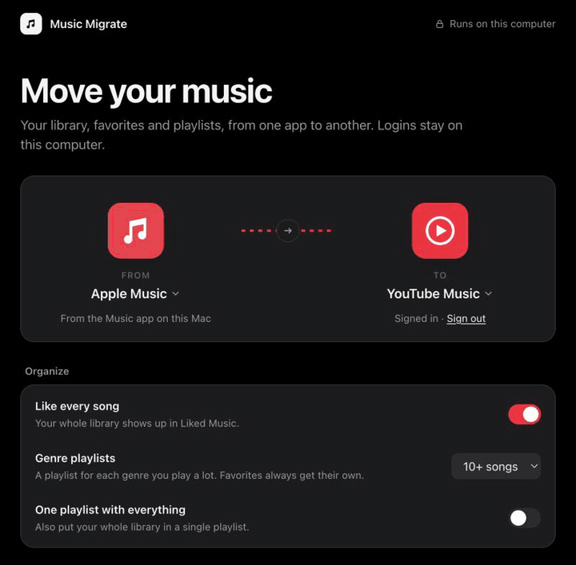
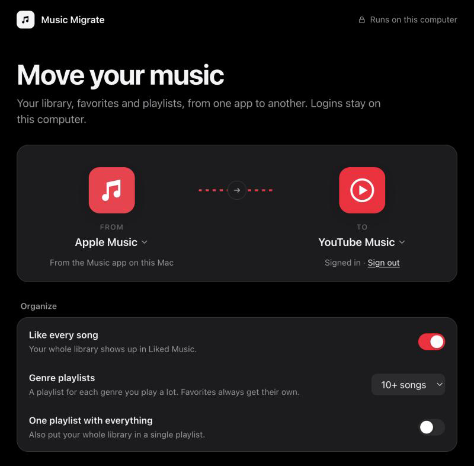
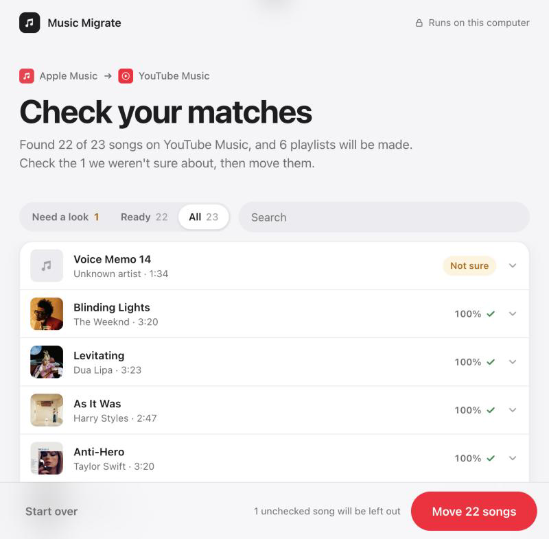
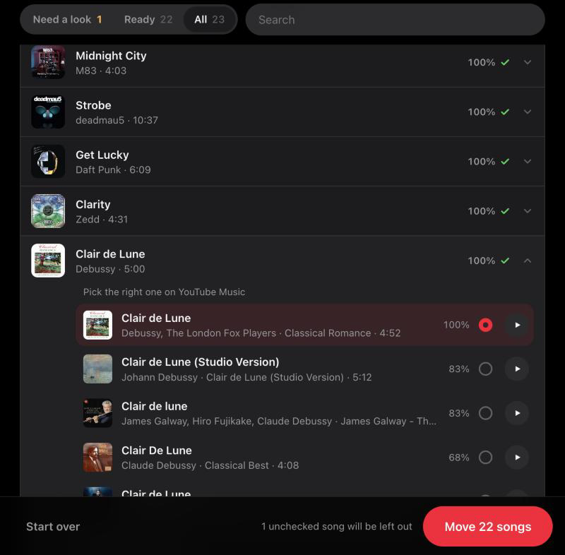
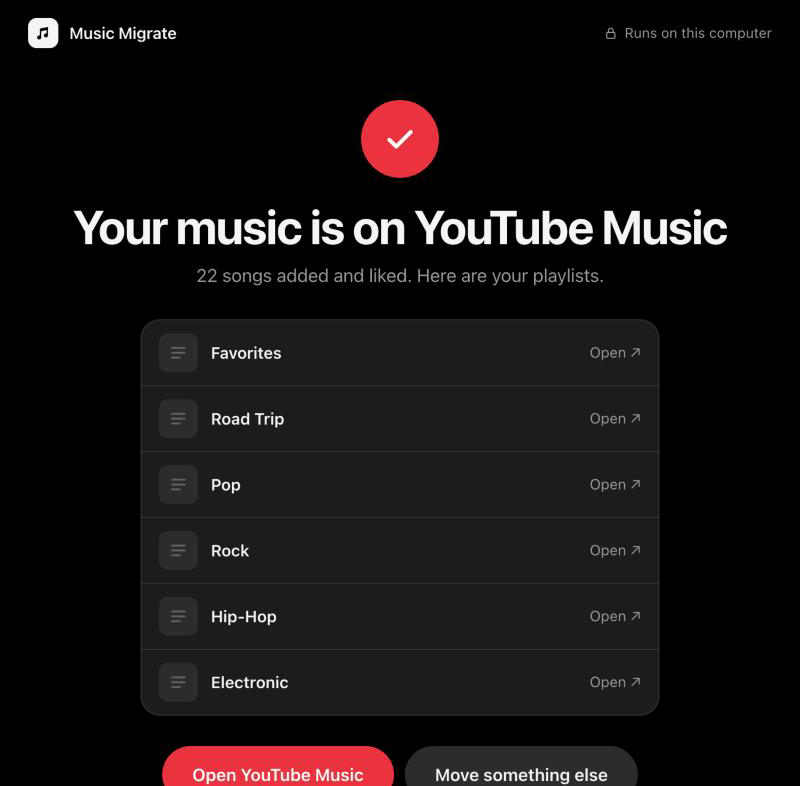

# Music Migrate

**Move your music library between Apple Music, Spotify and YouTube Music: every song, every playlist, organized and ready to play.**

Free and open source. It runs on your own computer, and your logins never leave it.

  

<p align="center"></p>

## What it does

1. **Pick where your music is and where it's going.**
2. **Find my songs.** It searches the new app for every song. Nothing on your account changes yet.
3. **Check the matches.** Every song shows its album art and how sure the match is. Anything uncertain is flagged so you can pick the right version (▶ plays it) or leave it out.
4. **Move.** Your songs get liked and your playlists get made. You get a link to each one.

| From ↓ / To → | YouTube Music | Spotify | CSV file |
|---|:---:|:---:|:---:|
| **Apple Music** (Mac) | ✅ | ✅ | ✅ |
| **Spotify** | ✅ | — | ✅ |
| **YouTube Music** | — | ✅ | ✅ |
| **CSV file** | ✅ | ✅ | — |

Moving *to* Apple Music isn't possible. Apple only allows it through MusicKit, which needs a paid Apple Developer account.

### How your music is organized on the other side

- **Every song is liked**, so your whole library shows up in Liked Music on YouTube Music, or Liked Songs on Spotify.
- **Favorites get their own playlist.**
- **Each genre you play a lot gets a playlist**, such as Pop, Rock or Bollywood. This works when moving from Apple Music or a CSV file.
- **Your own playlists are recreated** with the same names.
- Optionally, **one playlist with everything** in it.

### Matching you can trust

A song only counts as a match when the title and the artist both agree, and the length is within 30 seconds. Covers, karaoke versions and look-alike titles are rejected. "(feat. …)", "Remastered" and bracketed extras are ignored when comparing. Anything below the confidence bar waits for you instead of being guessed.

## Screenshots

| Pick your apps | Check your matches |
|---|---|
|  |  |
| **Pick the right version** | **Done** |
|  |  |

The app follows your system's light or dark mode, takes on the colour of the app you're moving to, and works on narrow windows. The screenshots use a sample library.

## Install

You need [uv](https://docs.astral.sh/uv/getting-started/installation/), a small installer for Python apps.

```bash
uv tool install git+https://github.com/berwinsingh/music-migrate
```

Then open the app:

```bash
music-migrate
```

It opens in your browser at a private address on your own computer. Close the terminal window to quit.

Running it again is safe. Searches are remembered, playlists with the same name are reused, and songs already in a playlist aren't added twice.

## Signing in

### YouTube Music

YouTube Music has no sign-in for apps like this, so you copy your browser's login once. The app shows these steps too:

1. Open [music.youtube.com](https://music.youtube.com) and make sure you're signed in.
2. Press <kbd>⌥⌘I</kbd> (<kbd>F12</kbd> on Windows), click the **Network** tab, type `browse` in its filter box, then click **Library** in YouTube Music's sidebar so a row shows up.
3. Right-click the `browse` row and choose **Copy → Copy as cURL**.
   - On Windows, choose **Copy as cURL (bash)**.
   - In Firefox it's under **Copy Value**.
   - In Safari, first turn on Settings → Advanced → Show features for web developers.
4. Back in the app, click **Paste login**.

You only need to sign in when you're ready to move. Finding and checking matches works without it.

### Spotify

Spotify asks everyone to register a small free "app" once:

1. Go to [developer.spotify.com/dashboard](https://developer.spotify.com/dashboard) and click **Create app**.
2. Give it any name. Add `http://127.0.0.1:8888/callback` as a Redirect URI and tick **Web API**.
3. Paste its Client ID and Client Secret into Music Migrate. A browser tab opens so you can approve access.

### Apple Music

There's nothing to sign in to. It reads the Music app on your Mac. The first time, macOS asks whether Music Migrate may control Music. Click **OK**.

## Privacy and security

- **Everything runs on your computer.** There's no Music Migrate server and no account. It only talks to the music services you choose.
- **Logins are stored only in `~/.music-migrate/`**, in a folder only your user account can open. **Sign out** in the app deletes them.
- **Other websites can't use it.** The app only answers its own page on `127.0.0.1`, so other websites you visit can't control it.
- **Nothing on your account changes until you press Move.**

## Command line

Pass any options to skip the app. This is handy for scripts.

```bash
music-migrate --from apple --to ytmusic --dry-run   # match only, writes migration-report.csv
music-migrate --from apple --to ytmusic
music-migrate --from spotify --to ytmusic
music-migrate --from ytmusic --to spotify
music-migrate --from apple --to csv --out my-library.csv
music-migrate --from csv --csv my-library.csv --to spotify
```

| Option | What it does |
|---|---|
| `--dry-run` | Match only. Writes `migration-report.csv` with every song and its score, weakest first. |
| `--no-like` | Don't like or save songs. Only make playlists. |
| `--library-playlist` | Also put the whole library in one playlist. |
| `--min-genre N` | Songs a genre needs before it gets a playlist (default 10, `0` turns it off). |
| `--threshold X` | How sure a match must be, from 0 to 1 (default 0.75). |

The command line uses the same logins as the app, so sign in through the app once first. For Spotify you can set `SPOTIPY_CLIENT_ID` and `SPOTIPY_CLIENT_SECRET` instead.

A CSV needs `title` and `artist` columns. `album`, `genre`, `duration` (in seconds), `fav` and `playlist` are optional. [Exportify](https://exportify.app) exports work as they are.

## Good to know

- YouTube Music is reached through [ytmusicapi](https://github.com/sigma67/ytmusicapi), an unofficial library. If YouTube changes something, an update to it usually fixes things.
- Songs that only exist on your computer, like voice memos or files you imported, can't be found on a streaming service. They show up as **Not sure** so you can skip them.
- Liking a large library takes a few minutes. YouTube Music is paced to avoid being rate-limited.

## Develop

```bash
git clone https://github.com/berwinsingh/music-migrate && cd music-migrate
uv run music-migrate                 # the app
uv run --with pytest pytest          # the tests
```

The app is one Python package with no web framework. The interface is a single HTML file, `music_migrate/index.html`, served by Python's built-in HTTP server.

## License

[MIT](LICENSE). Built on [ytmusicapi](https://github.com/sigma67/ytmusicapi) and [spotipy](https://github.com/spotipy-dev/spotipy), both MIT.

Not affiliated with Apple, Spotify or Google. Their names and logos belong to them.
